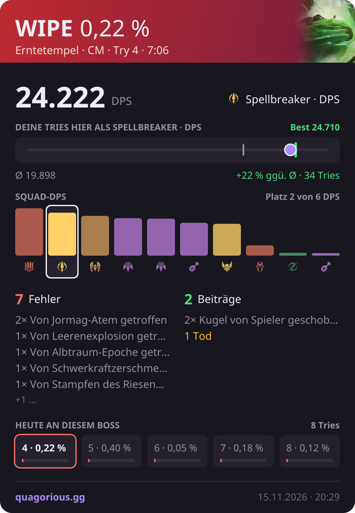
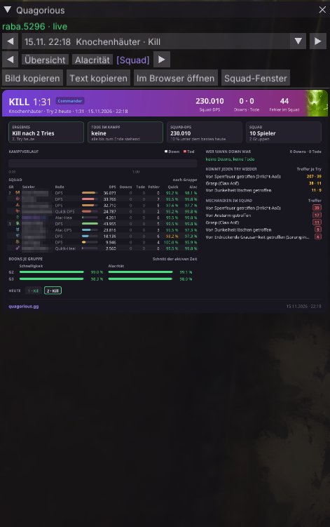
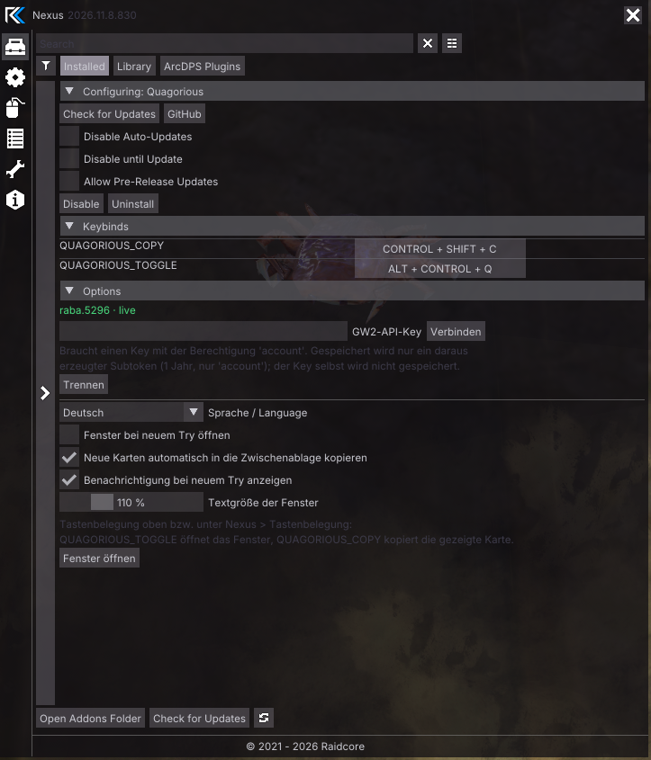
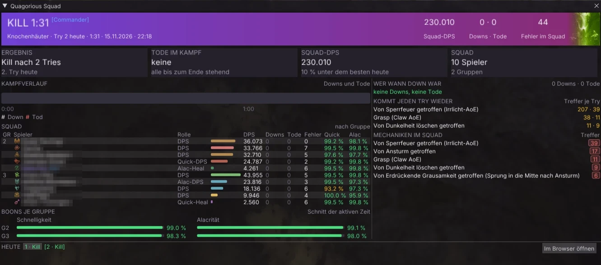
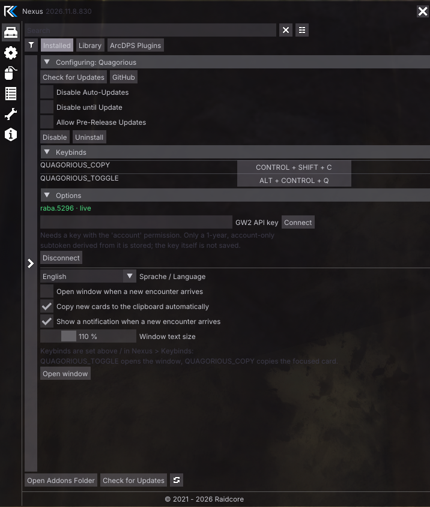
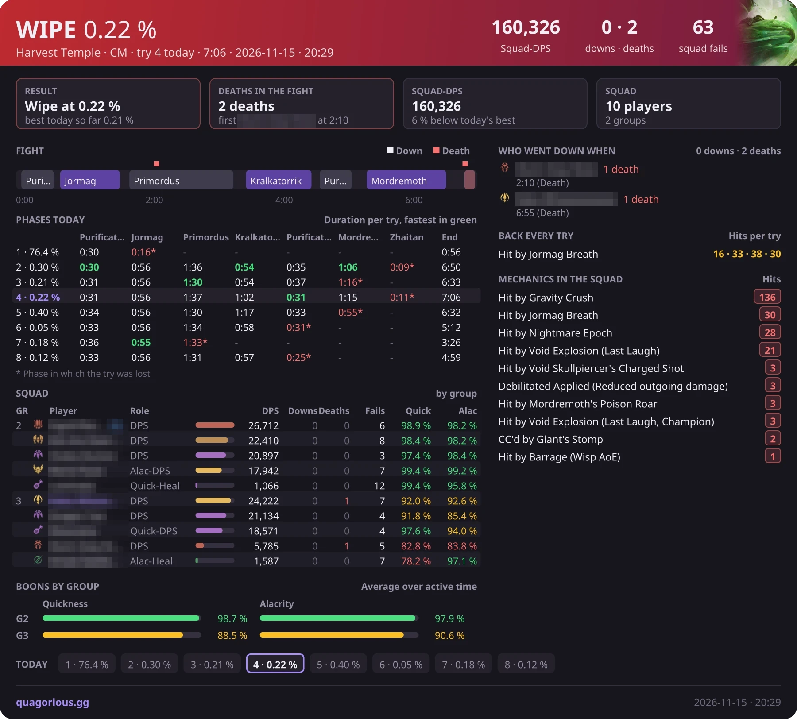
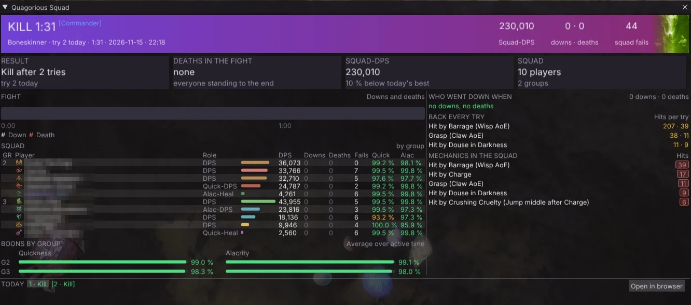

# Quagorious for Nexus

> [!WARNING]
> ## 🤖 This project is fully AI-written
>
> **Every part of this addon (the Rust code, the card renderer, the build and
> release setup, the docs and this notice) was written by an AI coding agent
> (Anthropic's Claude, through Claude Code).** This is agentic coding, not
> AI-assisted coding: the agent wrote, ran and fixed the code itself.
>
> The human maintainer chose what to build, made the decisions, reviewed the
> results and tested the addon in game. They did not write the code by hand.
>
> If you'd rather not use or support AI-generated software, this addon isn't
> for you, and that's a fair choice. We'd rather tell you upfront.
> Every release page carries the same notice.

A [Nexus](https://github.com/RaidcoreGG/Nexus) addon for Guild Wars 2, written in Rust.
It listens to the [quagorious.gg](https://quagorious.gg) live feed. When one of
your encounter logs is analysed, it renders share cards for that try and puts
one on the clipboard **as a PNG image**, ready to paste into Discord.

## Cards

Flip through them with the arrows in the window. The one you're looking at is
the one that gets copied, and the window remembers your choice for later tries.

| Card | Shows | Available |
|---|---|---|
| **Overview** | Kill time / wipe %, your DPS against your earlier tries, squad DPS, mistakes and contributions, today's tries at this boss | always (squad DPS needs the share token) |
| **Fight timeline** | Phases, where the try was lost, who went down first, deaths/downs before and after, squad DPS | share token + phases or a wipe |
| **Your boon** (e.g. Alacrity) | Uptime of the boon you provide, for each player in your subgroup (your party), with the main gap causes | share token + alac/quick role (or named as provider in your party) |
| **Squad** | The whole squad on one wide card: result, timeline with every down and death, phase times of today's tries, every player's DPS/downs/deaths/fails/boons, boons per group, who went down when, recurring mistakes, mechanics | share token |

The header shows the boss artwork when the boss id is known.

## Screenshots

Cards for one try (a Harvest Temple CM wipe as DPS Spellbreaker), as they're
copied to the clipboard:

| Overview | Fight timeline |
|---|---|
|  |  |

The boon card, when you provide quickness or alacrity to your party:

| Quickness (quick-DPS Harbinger, Fraenir of Jormag kill) | Alacrity (alac-heal Scourge, Deimos wipe) |
|---|---|
|  |  |

In game: the window with the try picker, the card carousel and the copy
buttons (showing the Overview and the Squad card), and the addon's page in
Nexus → Options.

| Window | Window, Squad card | Options |
|---|---|---|
|  |  |  |

## Squad card and window

The **Squad** card is the whole squad's view of the selected try (tries seen
live only). It's in the carousel like the other cards, so it's copied the
same way. **Squad window** shows the same view in its own window, with
details on hover (phase times, who went down, account names):

- result, boss artwork, date and start time, squad DPS, downs · deaths and
  the squad's fails in the header
- the phase timeline with every down and death (hover for details)
- phase times of today's tries at this boss, fastest in green
- every player: group, spec, role, DPS, downs, deaths, fails, quickness and
  alacrity uptime, plus the boon average per group
- who went down when, the mistakes that came back in every try today, and
  the squad's mechanics in this try


The Squad window in game:



**Window text size** in Nexus → Options → Quagorious enlarges the text of
both windows. See [ADR 0012](docs/ADR/0012-squad-panel-in-imgui.md).

## Language

**Sprache / Language** in Nexus → Options → Quagorious switches the whole
addon between German and English: cards, both windows, the options page,
messages and notifications. Mechanic names come from the analysis and are
partly English in German mode.

| Options | Window | Squad card |
|---|---|---|
|  |  |  |



## Setup

**Full guide, from arcdps and the Quagorious Uploader to the addon:
[English](docs/en/README.md) · [Deutsch](docs/de/README.md).** The addon only
shows tries that already reached Quagorious, so the uploader (or uploading
in the browser) has to be set up first.

1. Download `quagorious_share.dll` from the
   [latest release](https://github.com/quagorious/nexus/releases/latest)
   (it isn't in the Nexus addon library) and copy it into
   `Guild Wars 2/addons/`. Load it from the Nexus addon list. After that,
   Nexus keeps it up to date from the GitHub releases.
2. Go to **Nexus → Options → Quagorious**, paste a GW2 API key with the
   `account` permission, and click **Connect**.
   The addon exchanges the key for a 1-year, account-only **subtoken** and
   stores only that, in `addons/Quagorious/settings.json`. The key itself is
   not saved.
3. Play. Options decide what happens when a new try arrives: copy the card to
   the clipboard, show a Nexus notification ("KILL Faultierion 3:12 · Karte
   kopiert"), and/or open the window. **Sprache / Language** (Deutsch or
   English) applies to the whole addon: cards, both windows, the options
   page, messages and notifications.

| Action | Default keybind |
|---|---|
| Toggle window | `ALT+SHIFT+L` |
| Copy the focused card | `ALT+SHIFT+K` |

## How it talks to Quagorious

```
GW2 API key ──createsubtoken(account, +1y)──▶ subtoken          (stored)
subtoken    ──POST /api/blish/session──────▶ session token (24h, refreshed automatically)
session     ──GET  /api/blish/live-token───▶ live token
live token  ──SSE  {liveUrl}/api/blish/events
session     ──GET  /api/blish/encounters            (your tries, newest first, max 20)
session     ──GET  /api/blish/encounters/<id>?locale=de|en
```

The live feed sends `event: ping` every 25 s and, per upload, one message:

```json
{"type":"encounter","id":24499,"token":"…","bossId":132097,"bossName":"Cairn",
 "cm":0,"success":true,"bossHpLeft":0,"durationMs":122064,"timeStart":…,"seq":4,
 "accounts":[…squad…]}
```

`token` is the try's **share token**: the web link is
`https://quagorious.gg/app/encounters/<token>`, and the website's full analysis
(phases, every player's DPS and boon uptime) is public at
`/api/encounters/<id>?share=<token>`. The module API has neither, so the
extra cards and the boss image are only available for tries whose token the
addon knows. Tokens are kept in `addons/Quagorious/tokens.json`.

Other files in `addons/Quagorious/`: `gw2_specs.json` and `icons/` (spec icons
from the GW2 API), `bosses/` (boss artwork; ids → URLs in
`assets/boss_images.json`, the same table quagorious.gg uses).

## Building (from Linux)

```sh
rustup target add x86_64-pc-windows-msvc   # once
cargo install cargo-xwin                    # once
cargo xwin build --release --target x86_64-pc-windows-msvc
# → target/x86_64-pc-windows-msvc/release/quagorious_share.dll
```

### Releases (GitHub Actions)

Pushing a `v<version>` tag builds the DLL on a Windows runner and then
publishes a GitHub release with `quagorious_share.dll` and `checksums.txt`
(SHA-256) attached (`.github/workflows/release.yml`). Other pushes don't
trigger a build.

1. Bump `version` in `Cargo.toml` (Nexus shows this version), commit, push.
2. Tag that commit `v<version>` and push the tag:

   ```sh
   git tag v0.3.0 && git push origin v0.3.0
   ```

   A tag that doesn't match `Cargo.toml` fails the build before compiling.
3. Optionally edit the generated release notes on GitHub afterwards. They
   start with `.github/AI_NOTICE.md` (the AI notice and the setup links to
   the docs); keep it there.

Don't create the release by hand first: it must not exist before its DLL is
attached, or Nexus clients that check in between cache "no update".

To verify a download: `sha256sum -c checksums.txt` in the folder with both files.

**Auto-updates:** the addon declares this repository as its Nexus update
source. Nexus checks the GitHub releases, takes the highest `v<version>` tag
that has a `.dll` attached, and updates the addon when that version is newer
than the installed one. Pre-releases are only used if they're enabled for the
addon in Nexus. So publishing a release with a higher version is all it takes
to update every installation.

### Previewing the card without the game

The renderer lives in `crates/card` with no Windows dependencies:

```sh
tools/probe.sh   # needs ./.gw2key; dumps sample JSON to tools/samples/
# <encounter.json> <tries.json> <de|en> <out_prefix> [full.json] [dir with specs.json, icons/, bosses/]
cargo run -p quagorious_card --example render -- \
  tools/samples/enc_24458.json tools/samples/try_encounters.json de out/card \
  tools/samples/full/full_24458.json tools/samples/full
```

## Linux / Wine clipboard

The image goes on the Windows clipboard as `PNG` (registered format) and
`CF_DIB`. Wine's X11 driver exports these as `image/png` / `image/bmp`, so
pasting into Discord on the Linux side works (`xclip -selection clipboard -t TARGETS -o`
shows what's on offer).

## Layout

- `crates/card`: data model, i18n, tiny-skia/ab_glyph card renderer, plain-text summary
- `src/net.rs`: auth flow, REST calls, SSE client (its socket is shut down on unload so the thread exits immediately)
- `src/clipboard.rs`: Win32 clipboard (image + text)
- `src/cards.rs`: renders all variants of a try; share-token, spec-icon and boss-image stores
- `src/shell.rs`: open links in the browser (ShellExecute → `xdg-open` under Wine)
- `src/lib.rs`: Nexus glue, worker and live threads, imgui window and options
- `tools/probe.sh`, `tools/capture.sh`: dump API samples / record the live feed

How it fits together, and why it's built this way: [docs/ADR](docs/ADR/README.md).

Fonts: Noto Sans (SIL OFL), embedded.
