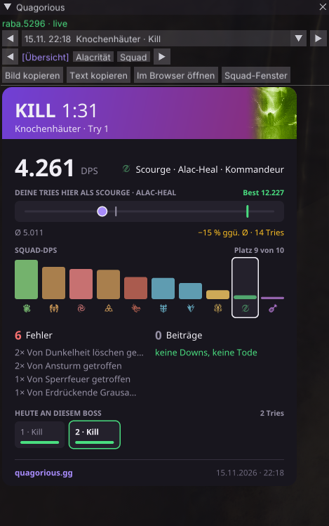

# Quagorious für Nexus

🇬🇧 [English version](../en/README.md)

Dieses Addon zeigt deine Ergebnisse von [Quagorious](https://quagorious.gg)
direkt in Guild Wars 2. Ein paar Sekunden nach einem Boss erscheint dein
Try im Spiel, und eine Share-Karte liegt als Bild in der Zwischenablage,
bereit zum Einfügen in Discord.



## Wie die Teile zusammenhängen

Das Addon ist das **letzte** Glied einer Kette. **Es zeichnet nichts auf
und lädt nichts hoch.** Es zeigt nur, was Quagorious schon ausgewertet hat.

```
 ┌──────────┐  .zevtc   ┌────────────────────┐  Upload   ┌───────────────┐  Live-Feed  ┌───────────────────┐
 │  arcdps  │ ────────▶ │ Quagorious Uploader│ ────────▶ │ quagorious.gg │ ──────────▶ │ dieses Nexus-Addon│
 │(zeichnet)│ Logdatei  │ (oder der Browser) │           │ (wertet aus)  │ deine Tries │ (zeigt, kopiert)  │
 └──────────┘           └────────────────────┘           └───────────────┘             └───────────────────┘
```

| Teil | Was er macht | Wo er läuft |
|---|---|---|
| **arcdps** | Zeichnet den Kampf auf und schreibt am Ende ein `.zevtc`-Log | im Spiel |
| **Quagorious Uploader** | Beobachtet den Log-Ordner und lädt jedes neue Log Sekunden nach dem Kampf hoch. Hochladen im Browser geht auch, aber von Hand | Windows (auch Linux) |
| **quagorious.gg** | Wertet das Log aus: DPS, Boons, Mechaniken, Phasen, Downs und Tode | die Website |
| **Dieses Addon** | Erfährt, wenn einer *deiner* Tries fertig ist, rendert Karten und kopiert eine in die Zwischenablage | im Spiel, über Nexus |

Ohne Uploader oder Hochladen im Browser hat das Addon nichts zu zeigen.
Uploader und Addon verbinden sich jeder für sich mit deinem
Quagorious-Account, auf verschiedenen Wegen (siehe
[So funktioniert es](how-it-works.md)).

## Einrichten, der Reihe nach

1. **[Quagorious und den Uploader einrichten](setup-quagorious.md)**:
   arcdps, ein Quagorious-Account, der Uploader.
2. **[Das Addon installieren und verbinden](install-addon.md)**: Nexus,
   die DLL von GitHub, der API-Key.
3. **[Das Addon benutzen](using-the-addon.md)**: Fenster, Karten,
   Squad-Ansicht, Optionen, Tastenbelegung, Sprache.

Außerdem:

- **[So funktioniert es](how-it-works.md)**: der Auth-Ablauf, welche Daten
  das Addon bekommt, was es speichert.
- **[Fehlersuche](troubleshooting.md)**: keine Karte, nur eine Karte,
  Verbindungsfehler, Linux.

> [!NOTE]
> Dieses Addon ist vollständig von einer KI geschrieben. Siehe den Hinweis
> in der [Projekt-README](../../README.md).
