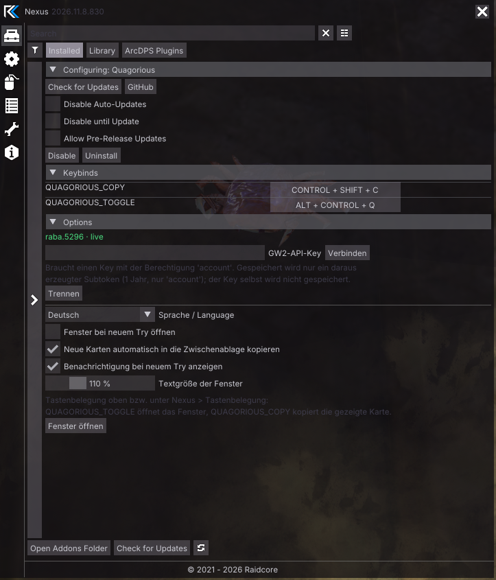

# Das Addon installieren und verbinden

🇬🇧 [English version](../en/install-addon.md) · [← Quagorious einrichten](setup-quagorious.md) · Weiter: [Addon benutzen →](using-the-addon.md)

Du brauchst: einen Quagorious-Account und Logs, die bei Quagorious ankommen
(siehe [Quagorious und den Uploader einrichten](setup-quagorious.md)).

## 1. Nexus

Das Addon ist ein [Nexus](https://raidcore.gg/Nexus)-Addon. Wenn du Nexus
noch nicht benutzt, installier es nach der Anleitung auf raidcore.gg.
Danach öffnet sich Nexus mit dem Spiel, sein Menü findest du oben links am
Bildschirmrand.

## 2. Die DLL herunterladen

Das Addon ist **nicht in der Addon-Bibliothek von Nexus**. Du lädst es
einmal von GitHub herunter. Danach aktualisiert Nexus es von selbst (siehe
unten).

1. Öffne das neueste Release:
   [github.com/quagorious/nexus/releases/latest](https://github.com/quagorious/nexus/releases/latest).
2. Lade unter *Assets* die Datei **`quagorious_share.dll`** herunter. Wenn
   du sie prüfen willst, auch `checksums.txt`.
3. Optional, Datei prüfen. In PowerShell, im Ordner mit dem Download:

   ```powershell
   Get-FileHash quagorious_share.dll -Algorithm SHA256
   ```

   Der Wert muss mit der Zeile in `checksums.txt` übereinstimmen. Unter
   Linux: `sha256sum -c checksums.txt`.

## 3. Installieren

1. Kopier `quagorious_share.dll` in den **Ordner `addons` im
   Spielordner**, dort, wo `Gw2-64.exe` liegt:

   ```
   Guild Wars 2\
   ├── Gw2-64.exe
   ├── d3d11.dll            ← Nexus
   └── addons\
       └── quagorious_share.dll   ← dieses Addon
   ```

2. Starte das Spiel (oder, wenn es schon läuft, öffne die Addon-Liste in
   Nexus) und **lade** dort „Quagorious".

Beim ersten Start legt das Addon den Ordner `addons\Quagorious\` für seine
Einstellungen und Caches an.

## 4. Verbinden



1. Öffne **Nexus → Optionen → Quagorious**.
2. Das Addon startet auf **Deutsch**. Unter **Sprache / Language** kannst
   du auf *English* umstellen.
3. Erstell einen GW2-API-Key auf
   [account.arena.net/applications](https://account.arena.net/applications).
   Die Berechtigung **`account`** reicht. Du kannst auch den Key nehmen,
   mit dem du dich bei Quagorious angemeldet hast.
4. Füg den Key bei **GW2-API-Key** ein und klick **Verbinden** (oder drück
   Enter).
5. Die Statuszeile oben zeigt dann die Verbindung, und der Live-Feed
   verbindet sich.

**Was mit dem Key passiert:** Das Addon holt damit einmal einen Subtoken
von der GW2-API, der nur die Berechtigung `account` hat und nach einem Jahr
abläuft. Gespeichert wird nur dieser Subtoken. **Der Key selbst wird nie
gespeichert.** Details stehen unter [So funktioniert es](how-it-works.md).

Nach einem Jahr verbindest du dich einfach neu mit einem Key. **Trennen**
löscht den Subtoken und stoppt den Live-Feed.

## 5. Prüfen

Mach einen Kampf. Ein paar Sekunden nachdem der Uploader das Log geschickt
hat, zeigt das Addon eine Benachrichtigung und öffnet standardmäßig sein
Fenster. Passiert nichts, siehe [Fehlersuche](troubleshooting.md).

## Updates

Das Addon nennt sein GitHub-Repository als Update-Quelle. Nexus prüft die
Releases dort, nimmt die höchste Version mit angehängter DLL und
aktualisiert das Addon, wenn diese Version neuer ist als die installierte.
**Du musst nichts erneut herunterladen.** Vorabversionen (Pre-Releases)
nimmt Nexus nur, wenn du sie für das Addon in Nexus einschaltest.

## Deinstallieren

1. Klick in den Optionen auf **Trennen**.
2. Entlade das Addon in Nexus und lösch `addons\quagorious_share.dll`.
3. Wenn du willst, lösch auch den Ordner `addons\Quagorious\`
   (Einstellungen, Subtoken, Caches).

Optional kannst du den API-Key auf account.arena.net löschen. Dann
funktioniert auch der daraus erzeugte Subtoken nicht mehr.

Weiter: **[Das Addon benutzen →](using-the-addon.md)**
