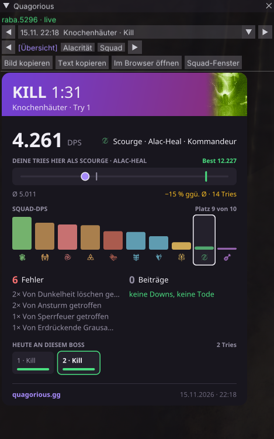
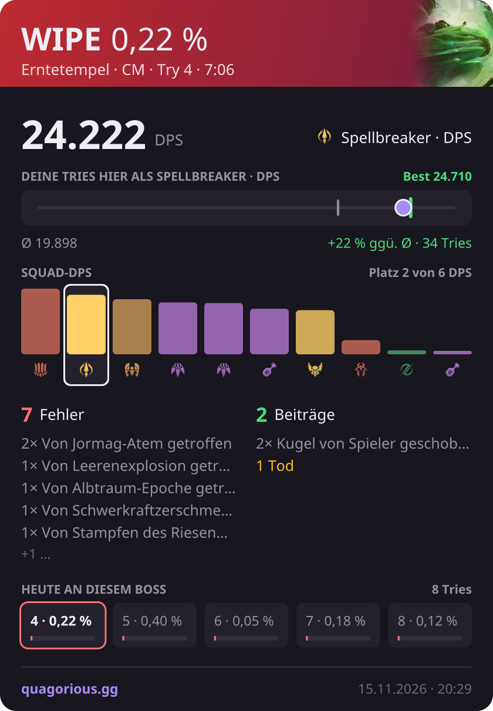
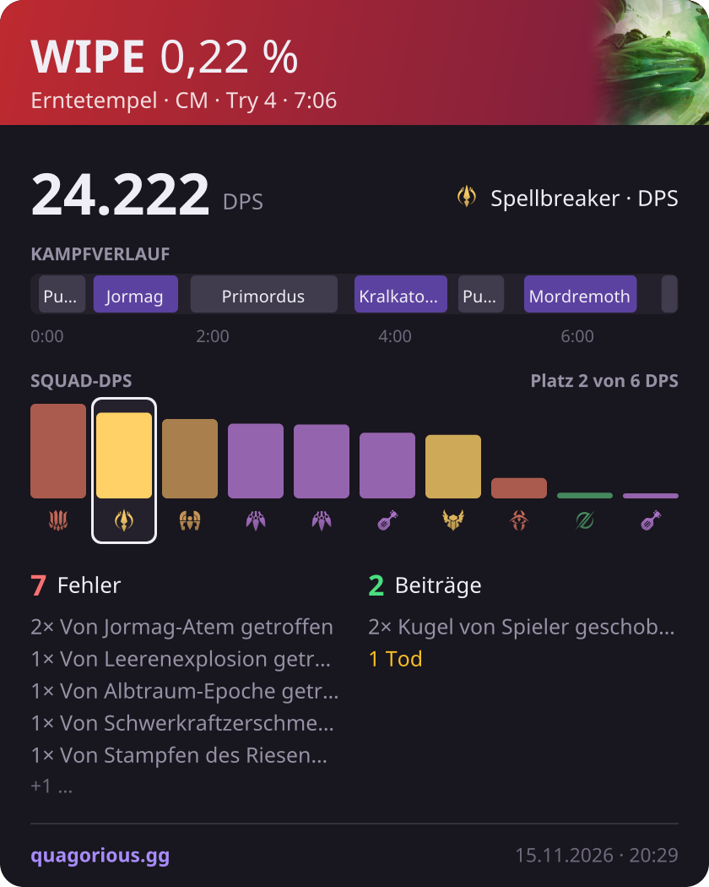
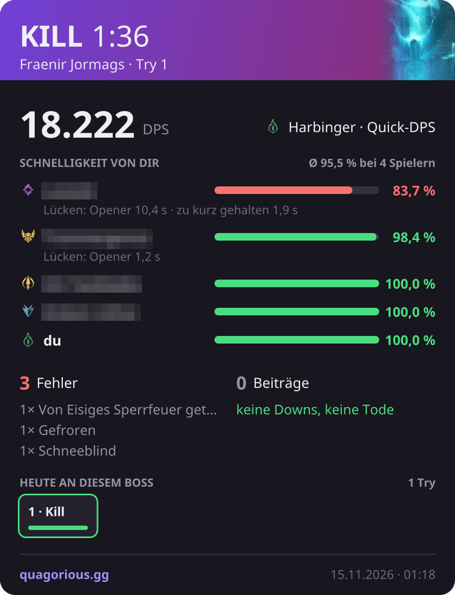
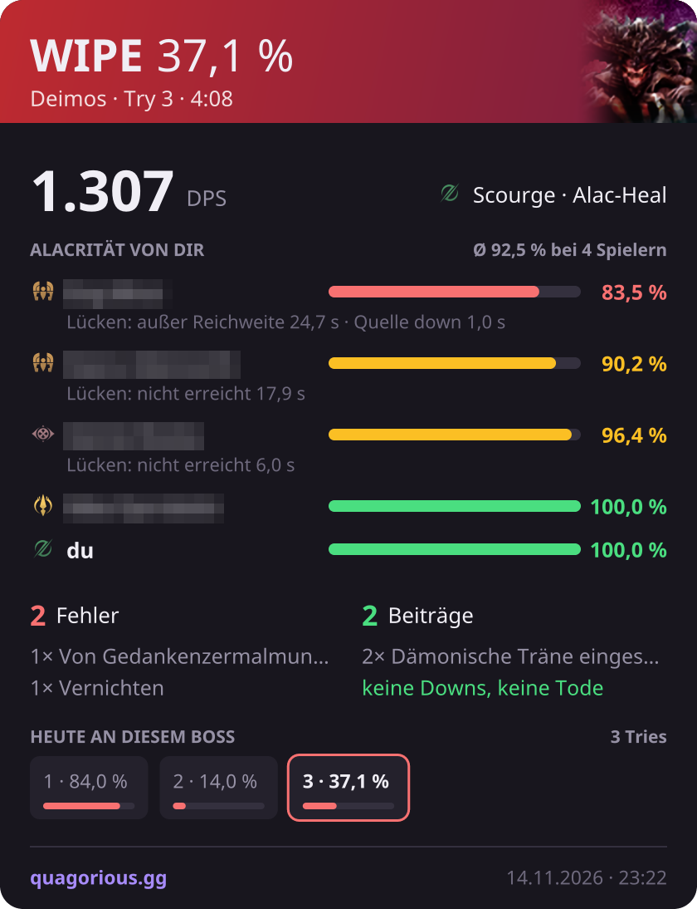
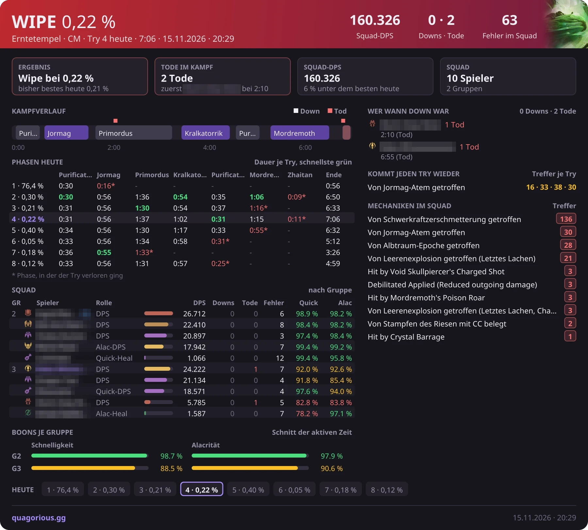
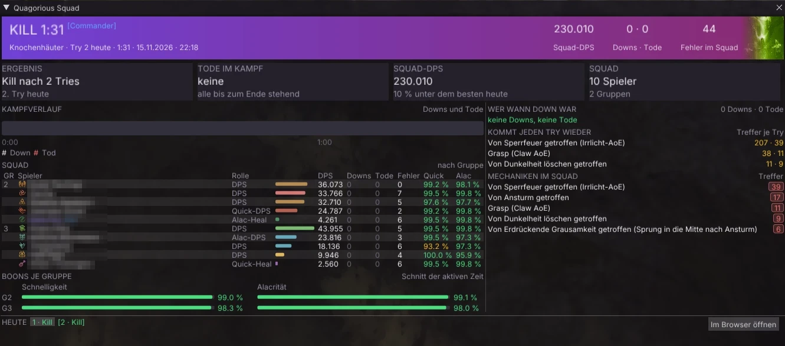

# Das Addon benutzen

[English version](../en/using-the-addon.md) · [← Addon installieren](install-addon.md) · Mehr: [So funktioniert es](how-it-works.md)

## Was nach einem Boss passiert

1. arcdps schreibt das Log, der Uploader schickt es, Quagorious wertet es
   aus.
2. Etwa eine Sekunde nach der Auswertung erfährt das Addon davon über den
   Live-Feed und rendert die Karten für diesen Try.
3. Je nach Optionen macht es dann Folgendes:
   - es kopiert die Karte, die du zuletzt angesehen hast, in die
     Zwischenablage,
   - es zeigt eine Nexus-Benachrichtigung, z. B.
     `Quagorious: KILL Cairn 2:02 · Karte "Übersicht" kopiert`,
   - es öffnet das Fenster.
4. In Discord: **Strg+V**. Die Karte wird als Bild eingefügt.

## Das Fenster

- **Try-Auswahl**: deine letzten Tries, der neueste zuerst. Die Tries von
  heute an diesem Boss stehen als Chips darunter.
- **Karten**: mit den Pfeilen durchblättern. Die Karte, die du siehst, wird
  kopiert, und das Fenster merkt sich deine Wahl für die nächsten Tries.
- **Bild kopieren**: die Karte als PNG in die Zwischenablage.
- **Text kopieren**: eine kurze Zusammenfassung als Text, mit dem Link zum
  Try.
- **Im Browser öffnen**: die volle Auswertung des Trys auf quagorious.gg.
- **Squad-Fenster**: die Squad-Ansicht in einem eigenen Fenster (siehe
  unten).
- **An Discord**: postet die gezeigte Karte in den Discord-Post des Abends
  (nur mit Webhook, siehe [Karten auf Discord posten](discord.md)).

## Die Karten

| Karte | Zeigt | Verfügbar |
|---|---|---|
| **Übersicht** | Kill-Zeit oder Wipe-%, deine DPS im Vergleich zu deinen früheren Tries, Squad-DPS, Fehler und Beiträge, die Tries von heute an diesem Boss | immer |
| **Kampfverlauf** | Phasen, wo der Try verloren ging, wer zuerst down war, Tode/Downs davor und danach | live gesehene Tries, mit Phasen oder bei einem Wipe |
| **Dein Boon** (z. B. Alacrity) | Uptime deines Boons für jeden in deiner Untergruppe, mit den wichtigsten Ursachen für Lücken | live gesehene Tries, wenn du Quickness oder Alacrity gibst |
| **Squad** | Der ganze Squad auf einer breiten Karte | live gesehene Tries |

*Live gesehen* heißt: Das Addon lief, als der Try ankam. Nur dann bekommt
es den Share-Link des Trys, den die weiteren Karten brauchen (mehr unter
[So funktioniert es](how-it-works.md#share-link-und-weitere-karten)).
Ältere Tries oder solche, während das Spiel zu war, haben nur die
Übersicht.

| Übersicht | Kampfverlauf |
|---|---|
|  |  |

| Quickness | Alacrity |
|---|---|
|  |  |

### Squad-Karte und Squad-Fenster

Die Karte **Squad** zeigt den ganzen Squad für einen Try: Ergebnis,
Phasen-Zeitleiste mit jedem Down und Tod, Phasenzeiten der Tries von heute
(die schnellste grün), jeden Spieler mit Gruppe, Spec, Rolle, DPS, Downs,
Toden, Fails und Boon-Uptime, Boons pro Gruppe, wiederkehrende Fehler und
die Mechaniken.

Das **Squad-Fenster** zeigt dieselbe Ansicht in einem eigenen Fenster, mit
Details beim Drüberfahren (Phasenzeiten, wer down ging, Accountnamen):

## Optionen

**Nexus → Optionen → Quagorious**

| Option | Standard | Wirkung |
|---|---|---|
| GW2-API-Key / Verbinden / Trennen | — | siehe [Addon installieren](install-addon.md#4-verbinden) |
| **Sprache / Language** | Deutsch | Sprache des ganzen Addons: Karten, beide Fenster, Optionen, Meldungen, Benachrichtigungen |
| Fenster bei neuem Try öffnen | an | Öffnet das Fenster bei jedem neuen Try |
| Neue Karten automatisch in die Zwischenablage kopieren | aus | Kopiert die zuletzt angesehene Karte |
| Benachrichtigung bei neuem Try anzeigen | an | Nexus-Benachrichtigung mit Ergebnis und Kopierstatus |
| **Textgröße der Fenster** | 100 % | Textgröße beider Fenster (80–200 %) |
| Discord: Webhook-URL / Prüfen | — | siehe [Karten auf Discord posten](discord.md) |
| Discord: Automatisch posten | Aus | Aus, Nur Kills, Jeder Try |
| Discord: Nur posten, wenn ich Kommandeur bin | aus | Postet nur Tries, in denen du das Kommandeur-Zeichen hattest |

Tipp für den Raid: *automatisch kopieren* und *Benachrichtigung* an,
*Fenster öffnen* aus. Dann liegt die Karte nach jedem Boss zum Einfügen
bereit, und nichts ist im Weg.

Mechaniknamen kommen aus der Auswertung von Quagorious und sind im
deutschen Modus teilweise englisch.

## Tastenbelegung

| Aktion | Standard | Name in Nexus |
|---|---|---|
| Fenster ein/aus | `ALT+SHIFT+L` | `QUAGORIOUS_TOGGLE` |
| Gezeigte Karte kopieren | `ALT+SHIFT+K` | `QUAGORIOUS_COPY` |

Ändern kannst du sie in Nexus unter Tastenbelegung.

## Linux (Wine/Proton)

Die Karte kommt als PNG und als Bitmap in die Zwischenablage. Wine reicht
beides an die Linux-Seite weiter, Einfügen in Discord unter Linux klappt
also auch.
