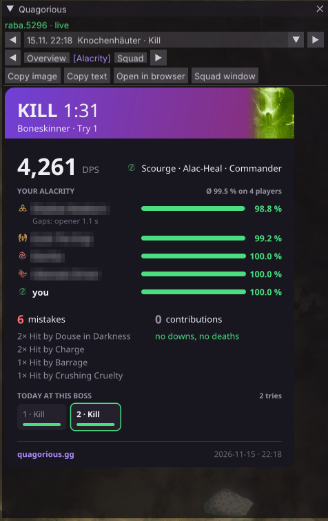

# Quagorious for Nexus

[Deutsche Version](../de/README.md)

This addon shows your [Quagorious](https://quagorious.gg) results inside
Guild Wars 2. A few seconds after a boss, your try shows up in game, and a
share card goes on the clipboard as an image, ready to paste into Discord.



## How the pieces fit together

The addon is the **last** link in a chain. **It doesn't record or upload
anything itself.** It only shows what Quagorious has already analysed.

```
 ┌──────────┐  .zevtc   ┌────────────────────┐  upload   ┌───────────────┐  live feed  ┌──────────────────┐
 │  arcdps  │ ────────▶ │ Quagorious Uploader│ ────────▶ │ quagorious.gg │ ──────────▶ │ this Nexus addon │
 │ (records)│  log file │ (or the browser)   │           │  (analyses)   │  your tries │ (shows, copies)  │
 └──────────┘           └────────────────────┘           └───────────────┘             └──────────────────┘
```

| Part | What it does | Where it runs |
|---|---|---|
| **arcdps** | Records the fight and writes a `.zevtc` log when it ends | in the game |
| **Quagorious Uploader** | Watches the log folder and uploads every new log seconds after the fight. Uploading in the browser works too, but by hand | Windows (also Linux) |
| **quagorious.gg** | Analyses the log: DPS, boons, mechanics, phases, downs and deaths | the website |
| **This addon** | Gets told when one of *your* tries is ready, renders cards, copies one to the clipboard | in the game, through Nexus |

Without the uploader, or uploads in the browser, the addon has nothing to
show. The uploader and the addon each connect to your Quagorious account on
their own, in different ways (see [How it works](how-it-works.md)).

## Setting up, in order

1. **[Set up Quagorious and the uploader](setup-quagorious.md)**: arcdps,
   a Quagorious account, the uploader.
2. **[Install and connect the addon](install-addon.md)**: Nexus, the DLL
   from GitHub, the API key.
3. **[Using the addon](using-the-addon.md)**: window, cards, squad view,
   options, keybinds, language.

More:

- **[How it works](how-it-works.md)**: the auth flow, what data the addon
  gets, what it stores.
- **[Troubleshooting](troubleshooting.md)**: no card showing up, only one
  card, connection errors, Linux.

> [!NOTE]
> This addon is fully AI-written. See the notice in the
> [project README](../../README.md).
