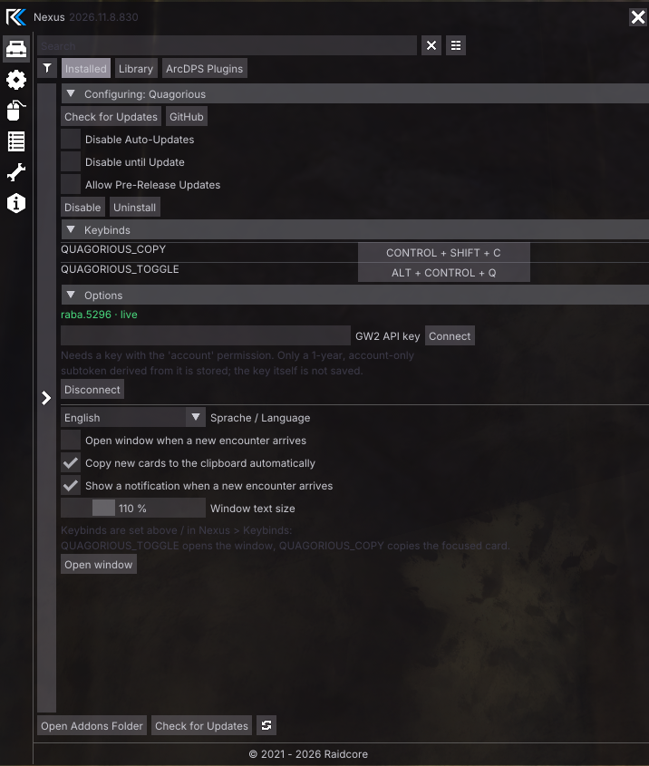

# Install and connect the addon

🇩🇪 [Deutsche Version](../de/install-addon.md) · [← Set up Quagorious](setup-quagorious.md) · Next: [Using the addon →](using-the-addon.md)

You need: a Quagorious account and logs that reach Quagorious (see
[Set up Quagorious and the uploader](setup-quagorious.md)).

## 1. Nexus

The addon is a [Nexus](https://raidcore.gg/Nexus) addon. If you don't use
Nexus yet, install it following the instructions on raidcore.gg. After
that, Nexus opens with the game, and you'll find its menu in the top left
corner of the screen.

## 2. Download the DLL

The addon is **not in the Nexus addon library**. Download it once from
GitHub. After that, Nexus updates it by itself (see below).

1. Open the latest release:
   [github.com/quagorious/nexus/releases/latest](https://github.com/quagorious/nexus/releases/latest).
2. Under *Assets*, download **`quagorious_share.dll`**. If you want to check
   it, download `checksums.txt` too.
3. Optional, check the file. In PowerShell, in the folder with the download:

   ```powershell
   Get-FileHash quagorious_share.dll -Algorithm SHA256
   ```

   The value must match the line in `checksums.txt`. On Linux:
   `sha256sum -c checksums.txt`.

## 3. Install

1. Copy `quagorious_share.dll` into the **`addons` folder of the game
   folder**, the one where `Gw2-64.exe` is:

   ```
   Guild Wars 2\
   ├── Gw2-64.exe
   ├── d3d11.dll            ← Nexus
   └── addons\
       └── quagorious_share.dll   ← this addon
   ```

2. Start the game (or, if it's already running, open the addon list in
   Nexus) and **load** "Quagorious" there.

On first start the addon creates the folder `addons\Quagorious\` for its
settings and caches.

## 4. Connect



1. Open **Nexus → Options → Quagorious**.
2. The addon starts in **German**. If you prefer English, first switch
   **Sprache / Language** to *English*.
3. Create a GW2 API key at
   [account.arena.net/applications](https://account.arena.net/applications).
   The **`account`** permission is enough. You can use the key you signed
   in to Quagorious with.
4. Paste the key into **GW2 API key** and click **Connect** (or press Enter).
5. The status line at the top switches to connected, and the live feed
   connects.

**What happens to the key:** the addon uses it once to get a subtoken from
the GW2 API that only has the `account` permission and expires after one
year. Only that subtoken is stored. **The key itself is never saved.**
Details are in [How it works](how-it-works.md).

After a year, connect again with a key. **Disconnect** removes the
subtoken and stops the live feed.

## 5. Check

Do a fight. A few seconds after the uploader has sent the log, the
addon shows a notification and, by default, opens its window. If nothing
happens, see [Troubleshooting](troubleshooting.md).

## Updates

The addon names its GitHub repository as its update source. Nexus checks
the releases there, takes the highest version with a DLL attached, and
updates the addon when that version is newer than the installed one.
**You don't have to download anything again.** Pre-releases are only used
if you enable them for the addon in Nexus.

## Uninstall

1. Click **Disconnect** in the options.
2. Unload the addon in Nexus and delete `addons\quagorious_share.dll`.
3. If you want, delete the folder `addons\Quagorious\` too (settings,
   subtoken, caches).

Optionally, delete the API key at account.arena.net. The subtoken derived
from it then stops working too.

Next: **[Using the addon →](using-the-addon.md)**
