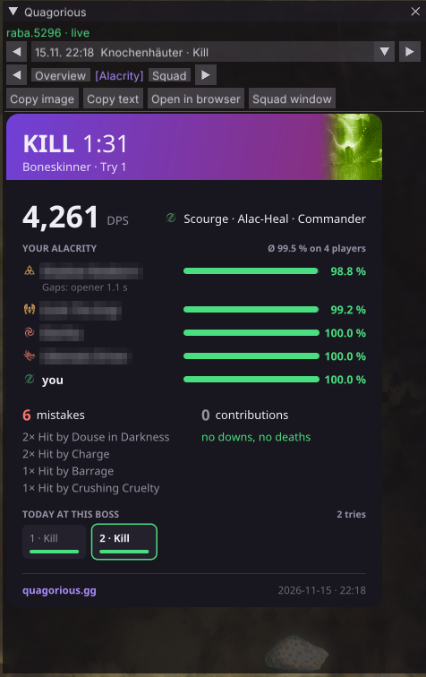
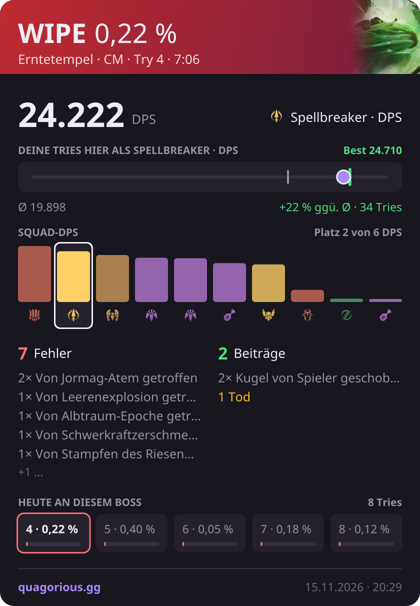
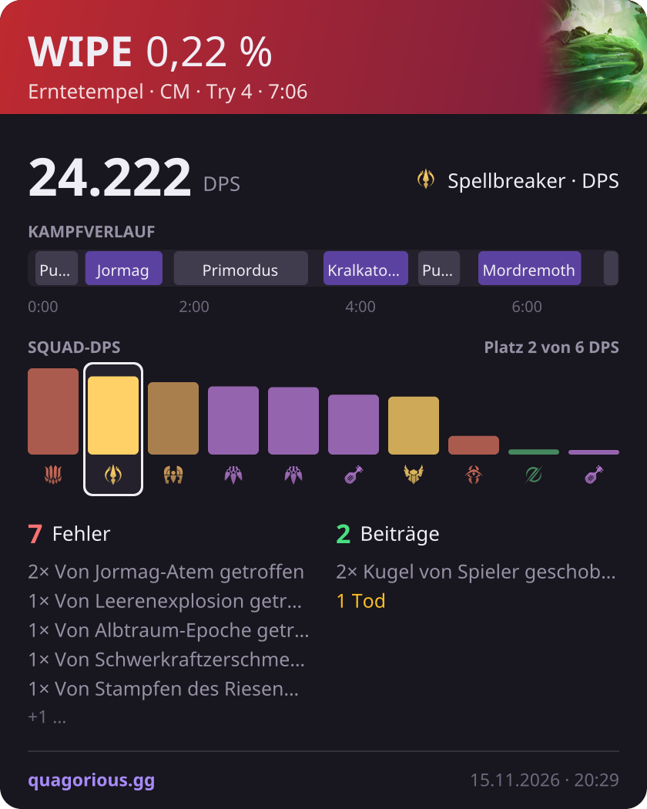
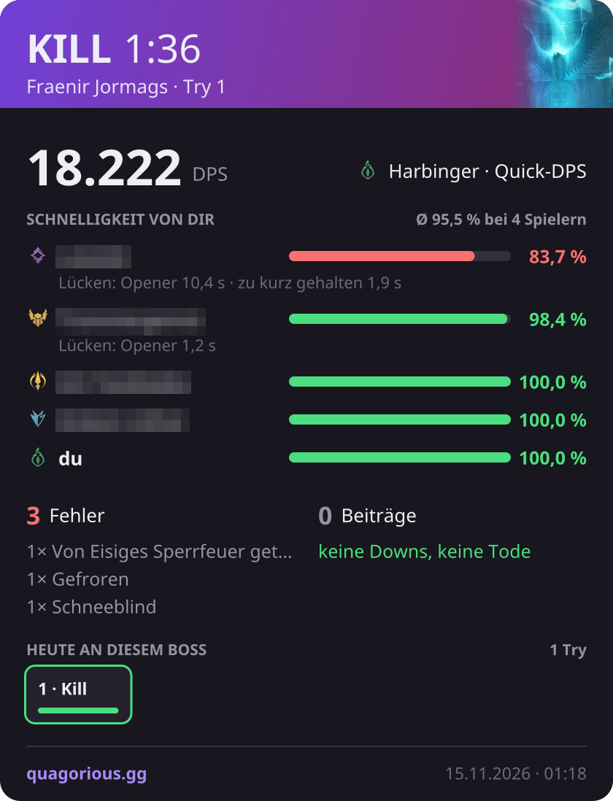
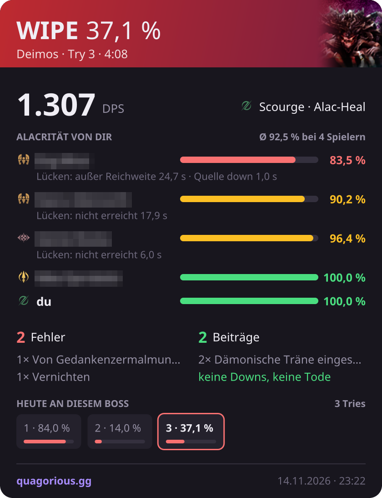
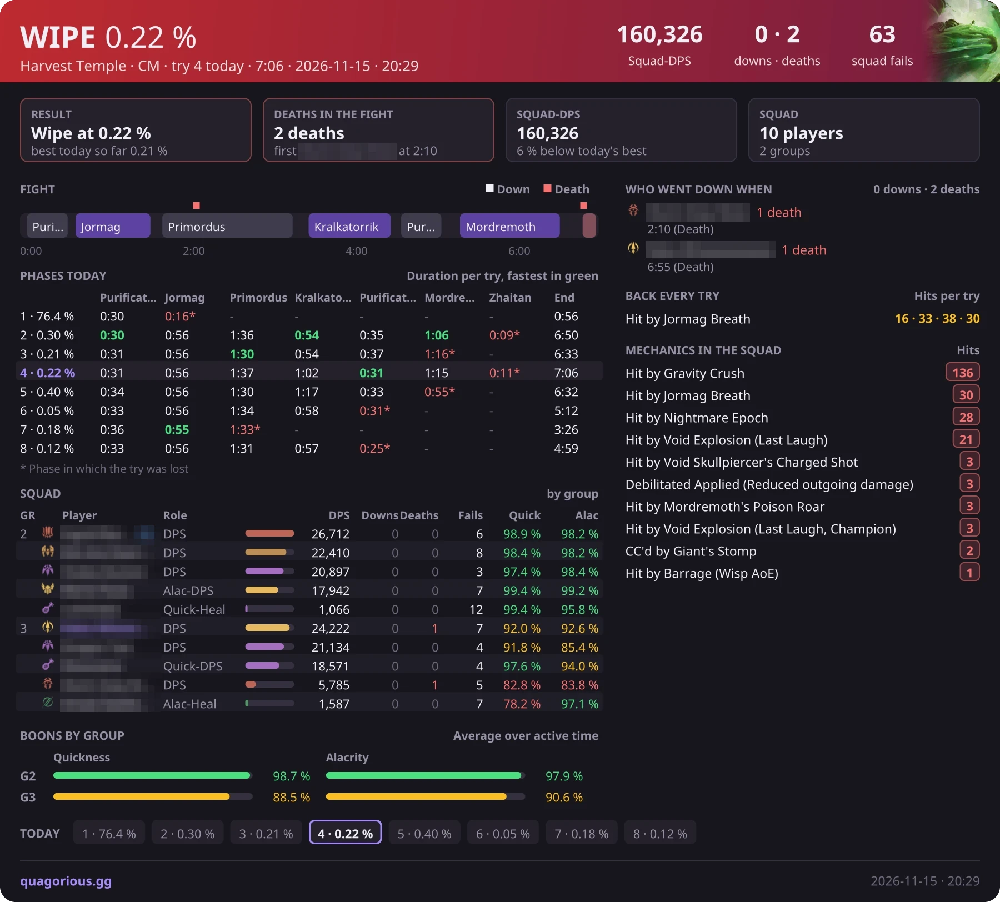
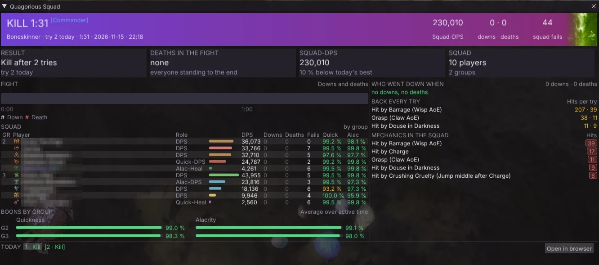

# Using the addon

[Deutsche Version](../de/using-the-addon.md) · [← Install the addon](install-addon.md) · More: [How it works](how-it-works.md)

## What happens after a boss

1. arcdps writes the log, the uploader sends it, Quagorious analyses it.
2. About a second after the analysis, the addon is told over the live
   feed and renders the cards for this try.
3. Depending on the options, it then:
   - copies the card you looked at last to the clipboard,
   - shows a Nexus notification, e.g.
     `Quagorious: KILL Cairn 2:02 · card "Overview" copied`,
   - opens the window.
4. In Discord: **Ctrl+V**. The card is pasted as an image.

## The window

- **Try picker**: your latest tries, newest first. Today's tries at this
  boss are shown as chips.
- **Cards**: flip through them with the arrows. The card you see is the
  one that gets copied, and the window remembers your choice for the next
  tries.
- **Copy image**: the card as a PNG on the clipboard.
- **Copy text**: a short summary as text, with the link to the try.
- **Open in browser**: the try's full analysis on quagorious.gg.
- **Squad window**: the squad view in its own window (see below).

## The cards

| Card | Shows | Available |
|---|---|---|
| **Overview** | Kill time or wipe %, your DPS against your earlier tries, squad DPS, mistakes and contributions, today's tries at this boss | always |
| **Fight timeline** | Phases, where the try was lost, who went down first, deaths/downs before and after | tries seen live, with phases or a wipe |
| **Your boon** (e.g. Alacrity) | Uptime of your boon for each player in your subgroup, with the main gap causes | tries seen live, if you provide quickness or alacrity |
| **Squad** | The whole squad on one wide card | tries seen live |

*Tries seen live* means the addon was running when the try came in. Only
then does it get the try's share link, which the extra cards need (more in
[How it works](how-it-works.md#share-link-and-extra-cards)). Older tries,
or ones from while the game was closed, only have the overview card.

| Overview | Fight timeline |
|---|---|
|  |  |

| Quickness | Alacrity |
|---|---|
|  |  |

> The example cards above are German. Card language follows the
> **Sprache / Language** option.

### Squad card and squad window

The **Squad** card shows the whole squad for one try: result, phase
timeline with every down and death, phase times of today's tries (fastest
in green), every player with group, spec, role, DPS, downs, deaths, fails
and boon uptime, boons per group, recurring mistakes and the mechanics.

**Squad window** shows the same view in its own window, with details on
hover (phase times, who went down, account names):

## Options

**Nexus → Options → Quagorious**

| Option | Default | Effect |
|---|---|---|
| GW2 API key / Connect / Disconnect | — | see [Install the addon](install-addon.md#4-connect) |
| **Sprache / Language** | Deutsch | Language of the whole addon: cards, both windows, options, messages, notifications |
| Open window when a new encounter arrives | on | Opens the window on every new try |
| Copy new cards to the clipboard automatically | off | Copies the card you looked at last |
| Show a notification when a new encounter arrives | on | Nexus notification with result and copy status |
| **Window text size** | 100 % | Text size of both windows (80–200 %) |

A tip for raids: turn on *auto-copy* and *notification*, turn off *open
window*. Then the card is ready to paste after every boss, and nothing is
in your way.

Mechanic names come from the analysis on Quagorious and stay partly English
in German mode.

## Keybinds

| Action | Default | Name in Nexus |
|---|---|---|
| Toggle window | `ALT+SHIFT+L` | `QUAGORIOUS_TOGGLE` |
| Copy the shown card | `ALT+SHIFT+K` | `QUAGORIOUS_COPY` |

You can change them in Nexus under Keybinds.

## Linux (Wine/Proton)

The card goes on the clipboard as PNG and as a bitmap. Wine passes both on
to the Linux side, so pasting into Discord on Linux works too.
